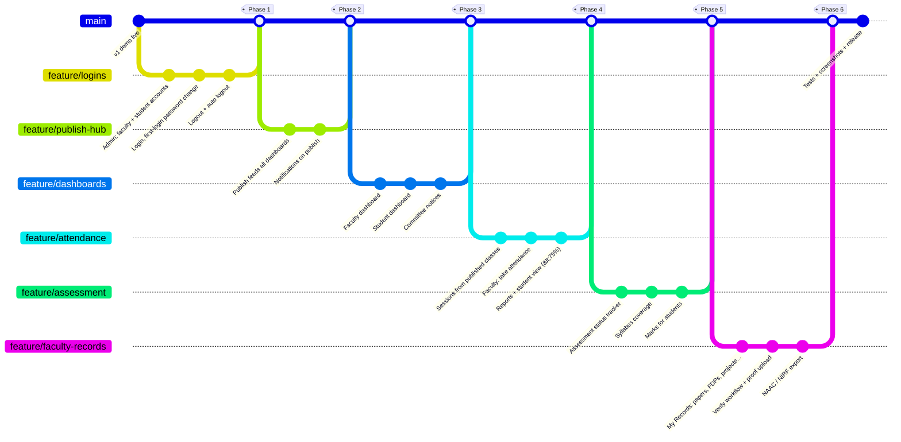
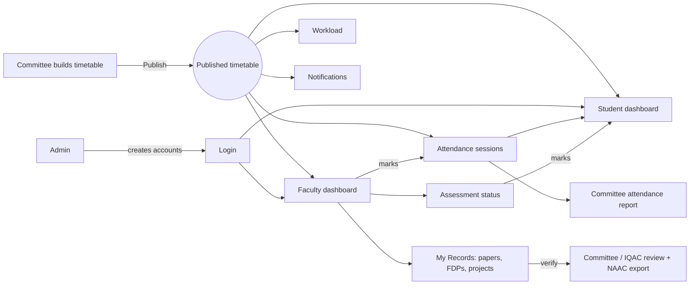

# Complete plan: Timetable Platform, phase 2

Everything hangs off the **published timetable**. When the committee publishes the master or the day's changes, every dashboard updates from that published version. Drafts never reach faculty or students.

## 1. The hub: what happens on "Publish"

| Who | What updates automatically |
|---|---|
| Faculty dashboard | Today's classes, changes affecting me, substitution duties, attendance sessions to mark |
| Student dashboard | Today's classes, "Changed" banner, attendance sessions for each subject |
| Attendance | One attendance session per published class (cancelled classes are skipped; substitutes mark their own) |
| Workload | Hours delivered, recalculated from published classes + substitutions |
| Notifications | Email / WhatsApp to the affected faculty and sections (simulated in the demo) |

## 2. Logins (accounts created by the admin)

- **Admin / Committee:** Faculty Accounts and Student Accounts pages. Create, bulk-import from Excel, disable, reset password.
- **Faculty login:** employee ID + password, change the password on first login, log out, automatic logout after 30 minutes idle.
- **Student login:** USN / roll number + password (or keep the current no-login view for timetables only and require login just for attendance and marks).
- Every account action goes into the Audit Trail.

## 3. Faculty dashboard

- Today's classes (next class, room, "Now")
- Changes affecting me this week
- Take attendance (pending sessions)
- Workload: delivered vs target
- Assessment status per subject: question paper set → test conducted → evaluated → marks uploaded
- Syllabus coverage per subject
- Leave balance and request status
- Substitution duties
- Low-attendance students (below 75%) in my classes
- Committee notices

## 4. Faculty record tracking ("My Records")

A personal portfolio each faculty member keeps up to date. The committee/IQAC can view and export it (useful for NAAC and NIRF reports and appraisals).

| Section | Fields |
|---|---|
| Research papers | Title, journal or conference, indexing (Scopus / WoS / UGC-CARE / ABDC), year, DOI, co-authors, PDF |
| Books and chapters | Title, publisher, ISBN, year |
| Conferences and FDPs | Attended / presented / organised, dates, certificate |
| Projects and grants | Funding agency, amount, status |
| Patents and consultancy | Number, status, client |
| Awards and recognitions | Title, body, year |
| Guest lectures and talks | Institution, topic, date |
| Qualifications | PhD status, certifications, MOOCs |

Each entry is **Draft → Submitted → Verified by committee/IQAC**, with a proof upload.
The dashboard shows a summary card: papers this year, FDPs attended, pending verifications.

## 5. Student dashboard (after login)

- Today's classes, then the week (from the published timetable)
- "Changed" banner for swaps, substitutions, room changes, cancellations
- My attendance per subject, with an alert below 75%
- Internal marks / assessment results (after the faculty member uploads them)
- Upcoming unit tests and deadlines
- Notices from the committee
- Download timetable (Excel / PDF), install as an app

## 6. Committee / admin additions

- Faculty Accounts and Student Accounts
- Attendance report (by section, subject, and students below 75%)
- Assessment summary (which subjects are behind)
- Faculty Records review (verify entries, export for NAAC/NIRF)
- Notices: post an announcement to faculty, a section, or everyone

## Git-style build plan

## How it all connects

